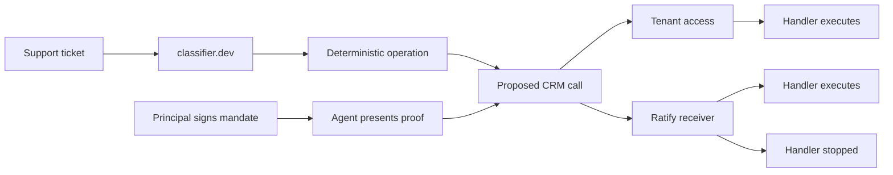
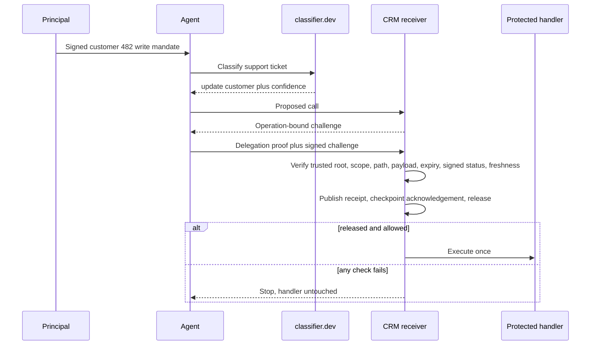

# classifier.dev × Ratify Protocol

An executable open-source reference for the boundary between semantic routing
and delegated authority.

[classifier.dev website](https://classifier.dev) · [Ratify Protocol website](https://ratifyprotocol.com) · [Ratify Protocol source code](https://github.com/identities-ai/ratify-protocol) · [Run it in Ratify Labs](https://labs.ratifyprotocol.com/classifier-dev/)

classifier.dev tells an agent what a request means. Ratify lets the system
carrying the consequence verify what that agent was authorized to do next.

**Status:** open-source independent reference implementation. This is not a
classifier.dev partnership, endorsement, or official reference architecture.

**Protocol line:** Ratify Protocol v2 (`2.0.0` prerelease). The v2 gate
passed on 2026-10-22 ([evidence](evidence/reference-evidence.md)). Protocol v2
is a prerelease: review so far is internal adversarial review, and external
independent review is a gate for `2.0.0`. The earlier Protocol v1 run
(`1.0.0-alpha.20`, 2026-09-19) is kept in the evidence file as dated history.

## About this project

[classifier.dev](https://classifier.dev) is a semantic classification service:
it receives text and returns structured dimensions such as the requested
operation and its confidence. That helps an agent route a request, but it does
not establish permission to carry out the resulting tool call.

[Ratify Protocol](https://ratifyprotocol.com) is an open protocol for portable,
receiver-verifiable delegated authority. A principal signs a bounded mandate
for an agent, and the receiver verifies the proof against the exact operation,
resource, context, validity window, revocation state, and one-time challenge
before allowing the side effect.

This repository puts the two ideas next to each other in a runnable Cloudflare
Worker reference. It deliberately shows both a competent tenant-access lane
and a Ratify authority lane so developers can see why authentication and
semantic confidence are not substitutes for exact delegated authority. The
reference is independent and does not claim to be produced, endorsed, or
maintained by classifier.dev.

## Start here

This lab is an interactive comparison, not a hosted product signup. It shows
what changes when a classifier's proposed action reaches two different
receivers:

1. Run the lab locally with the commands below.
2. Choose **Wrong account** and click **Run selected case**.
3. Read the two results: ordinary tenant access executes the update for valid
   customer 007, while the Ratify receiver stops it because the signed mandate
   is for customer 482.
4. Choose **Exact mandate** and run it again. Both receivers allow the call.
5. Try the remaining cases to see operation mismatch, one successful request followed by a stopped replay, and revocation.

The lesson is simple: classification proposes an action; the receiver that
owns the side effect decides whether that exact action is authorized.

## What this reference uses

This repository uses the Protocol v2 API of
[`@identities-ai/ratify-protocol`](https://github.com/identities-ai/ratify-protocol)
(`@identities-ai/ratify-protocol/v2`) directly. The protocol SDK issues the
demo delegation, signs the presentation, binds the proof to the proposed
operation, signs revocation status, and verifies and releases the decision in
the receiver without a call to any hosted service.

Until `2.0.0-beta.1` is published, `package.json` points at a local build of
the SDK vendored in `vendor/` (built from the protocol source at commit
`5f1093e`). Each place that switches to the published package at release is
marked `RATIFY_V2_PIN`.

It does **not** use
[`@identities-ai/ratify-receiver`](https://github.com/identities-ai/ratify-receiver).
That is a separate TypeScript helper for a server that chooses the managed
Ratify Verify service and wants a guarded handler API. This lab is intentionally
an open, self-contained protocol reference: `src/demo-session.ts` implements
the demonstrator receiver with a SQLite-backed challenge issuance store, exact
operation binding, expiry, signed revocation status, a trusted-principal key
pin, single-use replay protection, and release of the signed receipt before
the handler runs. A production TypeScript service can choose the receiver helper when
it wants that managed Verify integration; the two projects are complementary,
not interchangeable.

The concrete boundary: classifier.dev can route an ambiguous support request to
customer 007, and tenant access can execute because 007 is a valid Acme
customer. Ratify stops the same call because the signed mandate names customer
482.

## The problem

Classification is safe to offer without login because it produces a belief, not a side effect. The trust boundary appears after that result becomes a tool call.

A tenant-scoped credential can prove that an agent may reach a CRM and update customers in the Acme tenant. It does not carry the narrower fact that a principal authorized this agent to write only customer 482's billing address for ten minutes. Ratify additionally binds the presented proof to the exact proposed call and lets the receiver accept its challenge once.

This reference makes that difference visible. The same classifier-driven call goes to two competent receivers:

| Receiver | What it checks | What happens when an ambiguous account resolver chooses customer 007 |
| --- | --- | --- |
| Tenant access | Authentication, tenant, credential scope, object shape | Executes because 007 is a valid Acme customer |
| Ratify authority | All receiver controls plus trusted principal, agent, exact scope, resource path, operation binding, expiry, revocation, and single use | Stops because the signed mandate names customer 482 |

Ratify does not prove that classifier.dev is correct. It gives the receiver a cryptographic basis to allow or stop the action classification caused.



The two lanes receive the same proposed call. The first answers “can this
credential reach the tenant?” The second answers “did this principal authorize
this agent to perform this exact operation on this exact resource, now, and
only once?”

## Run it locally

Requirements: Node.js 22.13 or newer.

```bash
npm ci
cp .dev.vars.example .dev.vars
npm run dev
```

Open the local URL Vite prints. classifier.dev does not require an API key. `CLASSIFIER_API_KEY` is optional and only supports a partner or operator quota if one is provided.

The local demo uses public, fixed test identities. They are intentionally not secrets and must never be used outside this reference.

## What each part does

| Part | Responsibility | What it does not decide |
| --- | --- | --- |
| classifier.dev | Classifies the support ticket and returns an action label with confidence | Whether the action is authorized |
| Application mapping | Converts the label into a typed, deterministic operation and resource path | Whether the classifier chose correctly |
| Tenant access lane | Demonstrates ordinary authenticated tenant access | Exact principal mandate or revocation |
| Ratify protocol lane | Verifies the signed delegation, challenge, scope, path, operation, expiry, revocation, and freshness | Whether the business request itself is desirable |
| Protected handler | Performs the simulated CRM update only after the receiver allows | Any authorization that happens after the side effect |

## Run the executable gate

```bash
npm ci
npm run check
```

The gate regenerates and checks Cloudflare bindings, type-checks the Worker and browser client, runs five Durable Object integration cases in the Workers runtime, and builds the production bundle. No test is skipped. Each deny case asserts the released v2 reason and that only the expected check failed.

The cases encode the business boundary:

- exact mandate: both receivers execute;
- wrong account: tenant access executes, exact authority stops;
- different operation: classifier.dev proposes a read, while the mandate grants one write;
- copied request: bearer access executes twice, the receiver challenge is claimed once and the copy is a replay that is never evaluated;
- revoked authority: tenant access remains valid, the principal's status publisher signs a revocation under its separate status key, and the Ratify receiver stops with `delegation_revoked`.

## How the integration works

1. Before classification, the principal issues a short-lived `data:write` delegation to the support agent for `crm:tenant/acme/customers/482/billing-address`.
2. The Worker sends the ticket to classifier.dev's multidimensional `POST /v1/classify` API. The returned action label is not cosmetic: it selects the canonical operation and required Ratify scope.
3. Deterministic application code resolves the customer and constructs the proposed call. The model is not used for parsing, routing tables, retries, or authorization.
4. The receiving Durable Object issues a challenge with the v2 issuance helper. The challenge is bound to the expected agent key and to the session context the receiver built from the operation, and the record is durable before the challenge is returned.
5. The agent presents the signed delegation and challenge response.
6. The receiver reconstructs the operation, pins the complete principal root key, checks signed revocation status from the principal's status key, verifies the proof and claims the challenge once. Verification ends in a committed outcome that is not yet actionable.
7. The receiver publishes the signed verification receipt, waits for the checkpoint acknowledgement, releases the decision, and reaches the protected handler only when the released decision is `allowed()` at the receiver's clock.



## How to incorporate Ratify

Keep classifier.dev (or any other classifier) on the belief side of the boundary. Add Ratify at the receiver that owns the consequence:

1. Issue a Ratify delegation from the accountable principal to the agent. Put the narrow resource path, scope, expiry, and any application limits in the certificate.
2. Let the agent call the classifier and map its label to a typed operation with deterministic application code.
3. Have the receiver issue a fresh challenge with `issueChallengeV2` and reconstruct the operation and payload digest itself. Do not let the model or caller choose the trust root or final scope.
4. Call `verifyProofBundleV2` with the receiver's pinned root key, required scope, resource context, the principal's status key, and durable Part B stores. Publish the receipt, call `releaseV2Decision`, and invoke the protected handler only when the released decision is allowed.

The smallest receiver decision looks like this:

```ts
const outcome = await verifyProofBundleV2({
  bundle: proofWire,
  expected: await loadExpectedChallengeV2(issuanceStore, namespace, epoch, challenge),
  contextPolicy: newV2ContextPolicy(profile, true, sessionFields, receiverSessionContext),
  requiredScope: proposed.requiredScope,
  context: { hasResource: true, requestedResourceID: proposed.resourceId, requestedPath: proposed.path },
  statusKeys: new Map([[rootKeyID, { epoch: 1, key: statusPublicKey }]]),
  // namespace, replay epoch, clock, skew, tzdb version and status policy omitted
}, { claimStore, trust: pinnedRootKey, statusEvidence, statusJournal });

if (outcome.stage !== "committed") return denyWithoutCallingTheHandler();
const receipt = await receiptLog.publishV2Receipt(outcome.committed.claimID(), outcome.committed.receiptBody());
const result = await releaseV2Decision(outcome.committed, receipt, { verifierPublicKey, logID, claimStore, checkpoint });
if (result.status !== "released" || !(await result.decision.allowed(clock))) {
  return denyWithoutCallingTheHandler();
}
return protectedHandler(proposed);
```

This reference is the code developers can fork: the Cloudflare Worker boundary in `src/worker.ts`, the SQLite-backed receiver state in `src/demo-session.ts`, operation binding in `src/operation.ts`, and the browser comparison in `web/`. The Ratify SDK remains the portable protocol dependency. A production integration replaces the public demo identities, simulated issuer, deterministic fixture directory, in-run status publisher, and test-only Part B stores with its own principal identity, status publication, durable claim store, receipt log, independent checkpoint, policy, data store, and audit system.

For teams that want a managed trust, revocation, replay, audit, and availability layer instead of operating those pieces, the next step is the [Ratify Verify design-partner path](https://ratifyprotocol.com/?intent=proof#partners).

## Code map

| File | Responsibility |
| --- | --- |
| `src/classifier.ts` | Bounded classifier.dev request and strict response validation |
| `src/operation.ts` | Deterministic label-to-operation mapping and operation binding |
| `src/authority.ts` | Demo principal, agent, status and receiver keys; exact delegation issuance; presentation |
| `src/demo-session.ts` | Durable challenge issuance store, signed status, pinned-root verification, release, and protected counters |
| `vendor/` | Local build of the Protocol v2 SDK until `2.0.0-beta.1` is published |
| `src/access.ts` | Competent tenant-access comparison lane |
| `src/worker.ts` | Closed Labs origin, input bounds, privacy-preserving rate limit, and API |
| `web/` | Interactive side-by-side visualization |
| `test/worker.test.ts` | Allow and adversarial receiver outcomes in the Workers runtime |

## Cloudflare deployment

The application is one Cloudflare Worker with static assets and two SQLite-backed Durable Object classes. It is designed to sit behind the closed router at `labs.ratifyprotocol.com/classifier-dev`.

Production requires these Worker secrets:

- `LABS_ROUTER_TOKEN`: shared only with the Labs router; direct origin requests fail closed;
- `PRIVACY_SALT`: keys day-scoped caller pseudonyms used by the demo rate limiter.

`CLASSIFIER_API_KEY` is optional. Set secrets interactively; never put values on a command line or commit `.dev.vars`.

```bash
npx wrangler secret put LABS_ROUTER_TOKEN
npx wrangler secret put PRIVACY_SALT
npm run check
npx wrangler deploy --dry-run
```

Deployment is intentionally separate from Labs routing. Do not add the public Labs route until the source repository is public, the protocol profile is merged, the executable gate is green, and the origin has been independently verified to fail closed.

The checked-in local run record is [`evidence/reference-evidence.md`](evidence/reference-evidence.md).

## Open reference and Ratify Verify

Use this open-source reference to inspect and adapt the authority boundary yourself. It has no runtime dependency on a hosted Ratify service.

Ratify Verify is the managed path for organizations that do not want to operate trust-root distribution, revocation freshness, durable challenge storage, audit retention, observability, availability, and supported receiver adapters. Ratify Verify does not yet support Protocol v2, so this v2 reference has no managed Verify equivalent today.

## Production limitations

This repository is deliberately a reference, not a production CRM or identity system.

- The principal and agent identities are fixed public fixtures.
- The principal mandate is issued by a simulated trusted workflow. A production issuer must authenticate the principal and record the real approval or governing policy.
- The customer directory and Anderson resolver are deterministic fixtures used to expose a realistic downstream resolution error.
- Revocation status is signed by a status publisher under a status key separate from the root key, and the receiver checks it against that key. In this reference the publisher, its state and the status feed live inside each run. Production receivers need a published, freshness-bounded status feed, durable publisher state, and a defined outage policy.
- The claim store, receipt log, checkpoint and security journal are the SDK's **test-only** reference stores, rebuilt for every run. They demonstrate the v2 decision path, including replay rejection and release, inside one run; they are not durable and this deployment is not a production-shaped v2 receiver. A production receiver supplies durable Part B stores and an independent checkpoint (SPEC-v2 §7).
- Durable Objects provide durable challenge issuance records and counters, but this reference does not implement multi-region disaster recovery or audit export.
- classifier.dev inputs leave the Ratify Worker. Review its privacy terms and minimize sensitive ticket content before using the pattern with real data.
- The browser UI is an explanatory surface. Authorization remains entirely in the receiver.

## Security

The receiver owns enforcement. It holds the trusted root, reconstructs the requested operation from validated application inputs, binds the Ratify proof to that operation, and keeps the handler unreachable except through the allow branch.

Report vulnerabilities privately to the security contact published by the Ratify Protocol project. Do not include secrets, customer data, or live exploit material in a public issue.
